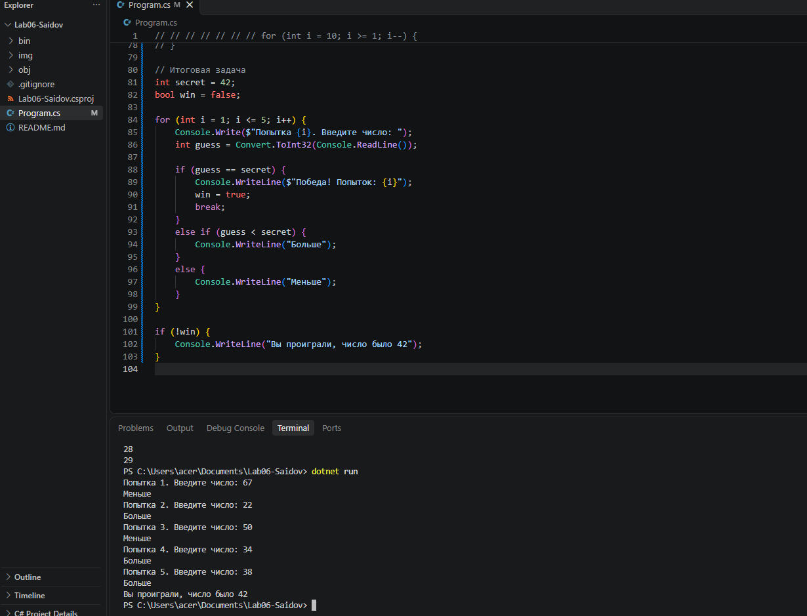
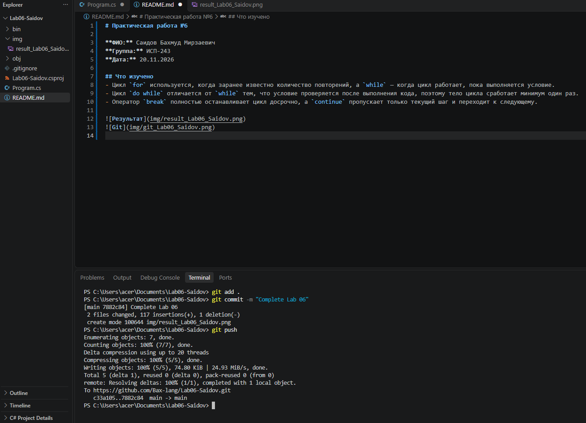

# Практическая работа №6

**ФИО:** Саидов Бахмуд Мирзаевич
**Группа:** ИСП-243
**Дата:** 20.11.2026

## Что изучено
- Цикл `for` используется, когда заранее известно количество повторений, а `while` — когда цикл работает, пока выполняется условие.
- Цикл `do while` отличается от `while` тем, что условие проверяется после выполнения кода, поэтому тело цикла сработает минимум один раз.
- Оператор `break` полностью останавливает цикл досрочно, а `continue` пропускает только текущий шаг и переходит к следующему.

